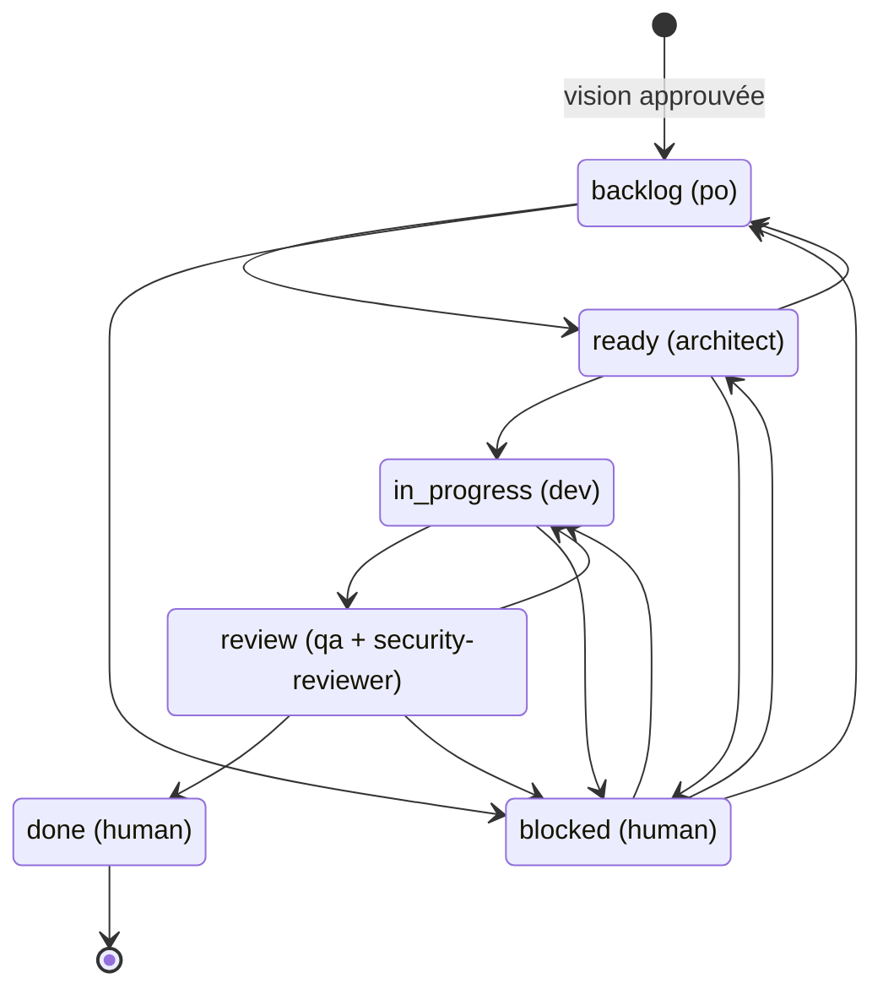

# Graphe d'exécution

> Généré par `just graph` depuis `.ai/graph.json`. Ne pas éditer.

| État | Responsable | Porte | Commande de la boucle |
|---|---|---|---|
| backlog | po | Definition of Ready : composant posé par l'architect + validation humaine du backlog |  |
| ready | architect |  |  |
| in_progress | dev | Definition of Done : just check | /build |
| review | qa + security-reviewer |  | /review |
| done | human | merge de la PR par l'humain |  |
| blocked | human |  |  |

Portes humaines : vision, backlog, architecture, blocked, merge. WIP : 3. Tentatives max par US : 2.
